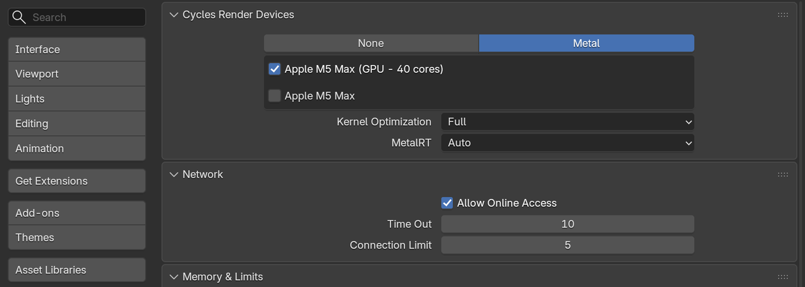
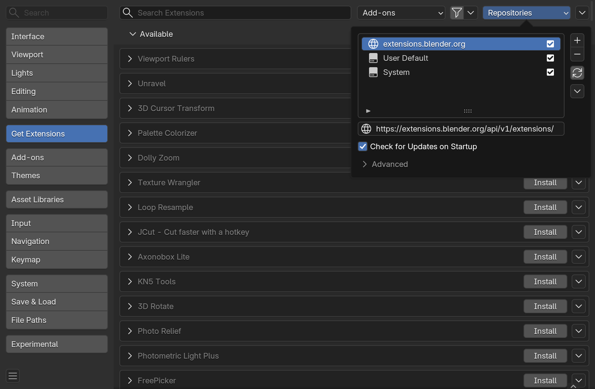
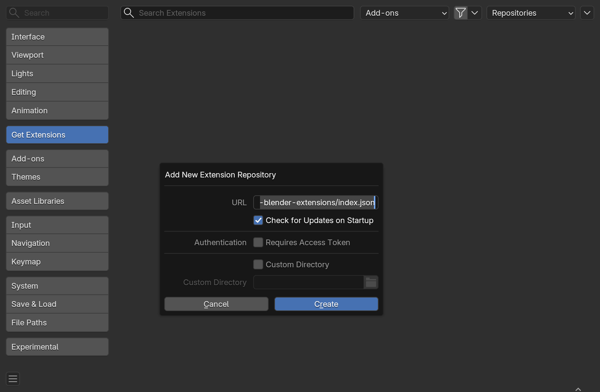
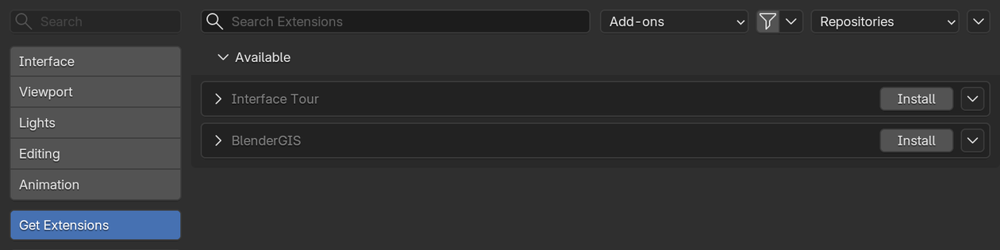
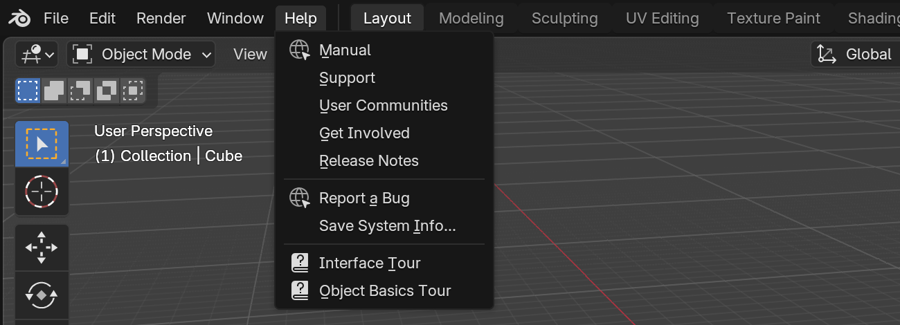
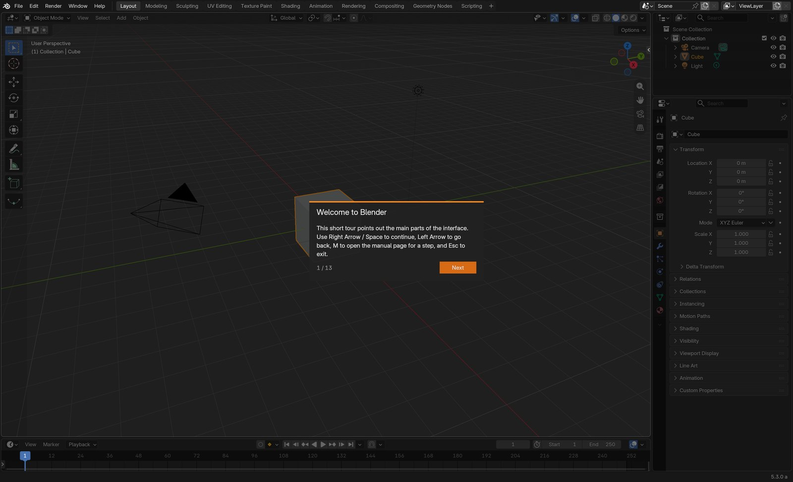
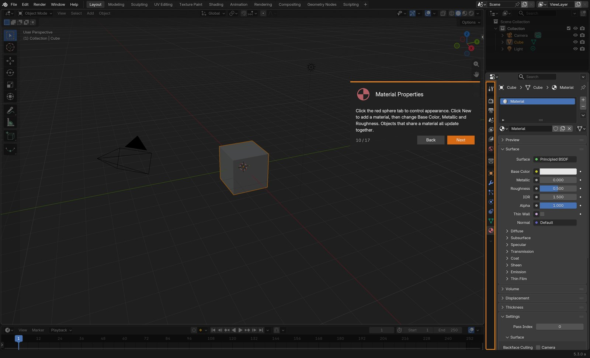
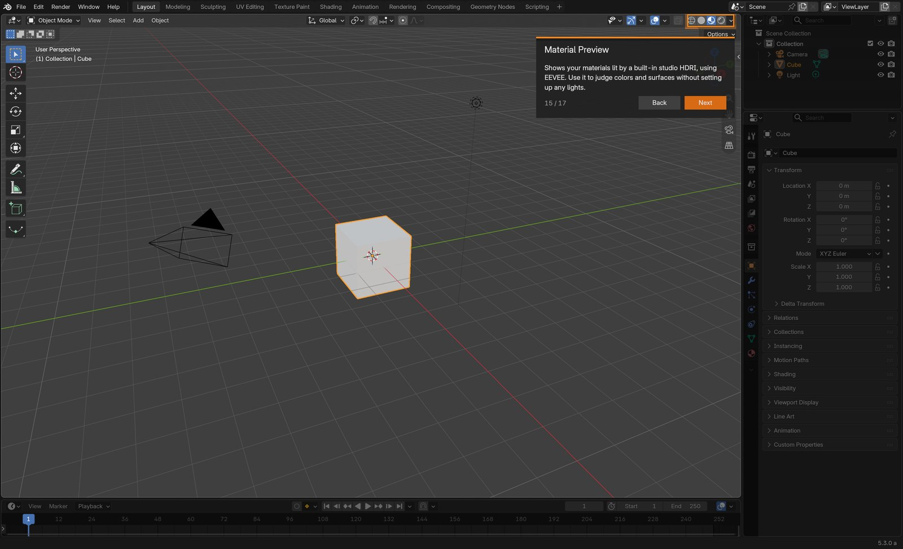

# AA Blender extensions tutorial: install, update, take the tours

This walks through adding the AA extension repository to Blender, installing **Interface Tour** and **BlenderGIS** from it, keeping them up to date, and starting the guided tours.

Requires Blender 4.3 or newer. The screenshots are from Blender 5.3 on macOS: menus are the same on Windows and Linux.

- [1. Allow online access](#1-allow-online-access)
- [2. Add the AA repository](#2-add-the-aa-repository)
- [3. Install the extensions](#3-install-the-extensions)
- [4. Take the tours](#4-take-the-tours)
- [5. Update](#5-update)
- [Troubleshooting](#troubleshooting)

## 1. Allow online access

Blender needs network access to read the repository and download the extensions.

Open *Edit > Preferences*, go to *System*, and in the *Network* panel tick **Allow Online Access**.



## 2. Add the AA repository

Go to *Get Extensions* and click **Repositories** at the top right. The popover lists the repositories Blender already knows (*extensions.blender.org* and the local ones). Click the **+** button on its right and choose **Add Remote Repository**.



Paste this URL:

```
https://mnmly.github.io/aa-blender-extensions/index.json
```

Tick **Check for Updates on Startup** (it is off by default, without it new versions are not shown), then click **Create**. The repository appears as *mnmly.github.io* in the list.



## 3. Install the extensions

Back in *Get Extensions*, search for **Interface Tour** and **BlenderGIS** and click **Install** on each. Blender picks the BlenderGIS build for your platform (Windows, macOS Intel or Apple Silicon, Linux), with all its Python dependencies.



Already installed BlenderGIS another way, from its own repository or from a zip with *Install from Disk*? Uninstall it first and restart Blender, then install it from here, so that only one copy is enabled.

## 4. Take the tours

Interface Tour adds two guided tours to the **Help** menu:

- **Interface Tour**: the parts of the window: Topbar, workspaces, areas and editors, 3D Viewport, header, toolbar, sidebar, Outliner, Properties, Timeline and Status Bar.
- **Object Basics Tour**: selecting, moving (G), rotating (R) and scaling (S) objects, undo, the Object, Data and Material tabs of the Properties editor, and the viewport shading modes, including X-Ray.



Each step dims the window except the part it explains, outlined in orange, with a description next to it:



| Key | Action |
|---|---|
| Right Arrow / Space / Enter, or **Next** | Next step |
| Left Arrow / Backspace, or **Back** | Previous step |
| M | Open the Blender manual page for the step |
| Esc | Exit the tour |

All other keys keep working while a tour is open, so you can try each shortcut as you read: hover the 3D Viewport, select the cube and press `G X 2 Enter` on the *Move* step.

In the Object Basics Tour, the Properties steps switch the Properties editor to the tab they describe, and show a large copy of its icon so you know which tab to look for:



The viewport shading steps switch the 3D Viewport through Wireframe, Solid, X-Ray, Material Preview and Rendered while you read. Your own shading setting comes back when the tour ends.



## 5. Update

With *Check for Updates on Startup* ticked, Blender checks the repository when it starts. When a new version is out, *Get Extensions* shows it next to the extension: click **Update** (or *Update All*).

**Restart Blender after updating BlenderGIS.** The update can replace the bundled libraries (pyproj, GDAL) while the old ones are still loaded: coordinate reprojections fail, or Blender can crash, until Blender is restarted.

## Troubleshooting

- **Nothing is listed after adding the repository**: check that *Allow Online Access* is ticked (step 1), then in the *Repositories* popover click the refresh button below **+** and **−**.
- **Blender reports that the repository cannot be reached**: the network may block GitHub. Open the repository URL in a web browser: it should show a page of text starting with `{"version": "v1"`.
- **A tour is not in the Help menu**: in *Preferences > Add-ons*, check that *Interface Tour* is enabled.

For using BlenderGIS (importing QGIS projects, basemaps, point clouds), see the [BlenderGIS tutorial](https://github.com/mnmly/BlenderGIS/blob/master/docs/tutorial.md), from step 5.
